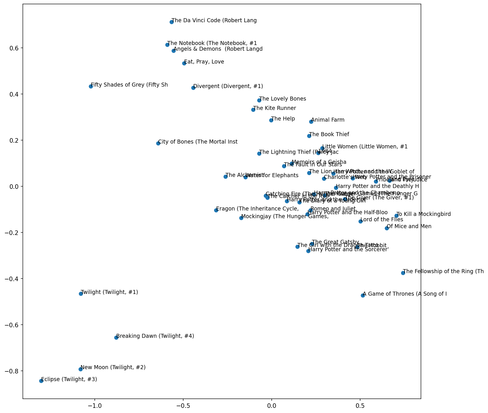

# 📚 Book Recommender (Collaborative Filtering)

A book recommendation model built from scratch with PyTorch + fastai, trained on ~980,000 real ratings from the [goodbooks-10k](https://www.kaggle.com/datasets/zygmunt/goodbooks-10k) dataset (53k users, 10k books).

Built as hands-on practice after fast.ai Lesson 7 (collaborative filtering).

## How it works

- Each user and each book gets a learned **embedding** (a 50-number "taste profile")
- Predicted rating = **dot product** of the user's and the book's embeddings + **user bias** + **book bias**, squashed into the 0–5.5 range with `sigmoid_range`
- Trained with **MSE loss**; **weight decay** to reduce overfitting
- The model is never told genres, authors or series. It learns them from rating patterns alone.

## Results (validation MSE, lower is better)

| Model                                       | Valid MSE | Typical error |
| ------------------------------------------- | --------- | ------------- |
| Baseline: always predict the average rating | ~1.0      | ~1.0 ★        |
| Plain dot product                           | 0.966     | 0.98 ★        |
| + bias + sigmoid range                      | 0.749     | 0.87 ★        |
| + weight decay (`wd=0.1`)                   | **0.716** | **0.85 ★**    |

Without weight decay, validation loss started rising after epoch 1 (overfitting); with it, validation loss kept improving.

## What the model learned

- **PCA on book embeddings:** the Twilight series formed its own tight cluster; school classics (To Kill a Mockingbird, Of Mice and Men, 1984) and epic fantasy (The Hobbit, Lord of the Rings, Game of Thrones) formed separate regions
- **"Books similar to…"** (cosine similarity):
  - _The Hobbit_ → _The Fellowship of the Ring_
  - _Twilight_ → _New Moon_, _Eclipse_, _City of Bones_

## Lessons learned

1. **Check row counts after every merge.** `ratings.book_id` matches `books.id`, not `books.book_id` (which is the Goodreads ID). The wrong merge silently dropped ~90% of the data.
2. **Selection bias:** the highest "book bias" went to niche books (e.g. study Bibles) rated mostly by their devoted readers, not to universally loved books.
3. **Noisy embeddings:** with ~100 ratings per book, similarity search over all 10k books returned random matches for _Twilight_. Restricting the search to the 1,000 most popular books (with reliable embeddings) fixed it.

## Tech

Python · PyTorch · fastai · pandas · Kaggle (GPU)

## Run it

Open `book_recommender.ipynb` on Kaggle, add the goodbooks-10k dataset as input, turn on the GPU, and run all cells.
